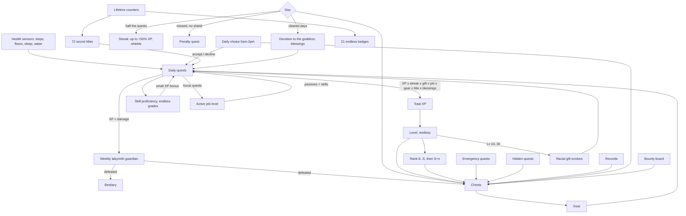

The rules: quests, streaks, jobs, skills, the labyrinth, races, gear and the long-term goals. Every number here comes from the game's code.

## How the systems connect

## Daily quests (reset at midnight)
| Quest | Sensor | Trains | Skill |
|---|---|---|---|
| Walk | Daily steps | Stamina (STA) | Swift Feet |
| Climb | Daily floors (or elevation in m/ft) | Strength (STR) | Mountain Step |
| Rest | Sleep duration (naps add up; counts toward the day you wake) | Vitality (VIT) | Deep Slumber |
| Drink water | Daily hydration | Intelligence (INT) | Water Magic |
| Lights out | When your main sleep started, against your bedtime target | Wisdom (WIS) | Clear Mind |

A quest pays up to 60 XP for progress plus a 40 XP jackpot for finishing. Walk and Climb pay a little more up to 150% of the goal. A day's progress never goes down, whatever the phone does. On the Status tab, **HP** is last night's rest and **MP** is today's water; both stop at 100%.

## Streak, shields and the Penalty Quest
- **Clear the day** by finishing half your quests, rounded up. Each streak day adds +5% XP, up to +50%.
- **Shields:** every 7 streak days earns one (hold 2). A missed day spends a shield instead of the streak.
- **Penalty Quest:** a missed day with no shield opens one. Finish one more quest than usual tomorrow and the streak survives; fail and it ends.

## Emergency quests and daily choices
- **Emergency quests** appear on about 30% of days between 10:00 and 18:30: "A runaway cart is loose in the market. Chase it down: 1,600 steps" in 60 minutes. Clearing one pays XP and a chest.
- **Failing one** during working hours costs nothing (*"Failing penalty: −140 gold… ERR0R. ERROR. Working hours detected."*). Outside them it costs 30 + 2 gold per level, at most 200 and never more than 10% of your gold; declining costs half. If Home Assistant wasn't watching when time ran out, there's no fine.
- **Daily choices** appear each morning (06:00–14:00), from one of 20 characters. Answer Yes or No. A **trade** moves XP from one quest to another for the day; a **bounty** or **timed bounty** pays XP and a chest for finishing a quest; a **contract** asks for N quests; **wagers** stake XP on a perfect day or on beating a goal by 30–50%. Declining is always free.
- **What a chest holds:** every chest holds one item, and an offer shows its odds (a bounty chest: common 25%, uncommon 35%, rare 28%, epic 10%, legendary 2%). When the AI writes what a character says, it's told exactly what the prize is, and a line that oversells it is thrown away.

## The bounty board
On the Quests tab, under the daily quests.
- **Daily side quests:** small, healthy tasks you can do in under 30 minutes ("Stretch for five minutes", "Message a friend"). You get 0 to 10 each morning (5 by default). They're on your honour, and one of them each day holds a bounty chest. Up to three, each pays about 30 XP plus one per level, and some gold; past three, each extra one adds half a side quest's worth to the day, shared out over all of them, so ten side quests pay about twice what three do, not three times. There are over a hundred built-in ones. Your AI writes them if it's set up; the rewards are always the game's. "Lena, I did my stretches" marks one done by voice.
- **Kids mode:** a parent posts chores for a child, each with its own reward (up to 300 XP, up to 300 gold, optionally a bounty chest), once, every day or every week. The child taps **Done**; a parent taps **Approve** (or **Not yet**) before the reward arrives. A parent is any Home Assistant admin, so link the child's own non-admin user to their adventurer. [`examples/life_rpg/automations/life_rpg_chore_approval.yaml`](../../examples/life_rpg/automations/life_rpg_chore_approval.yaml) sends a phone notification when a chore is waiting.

## Jobs (unlock at level 5)
Pick a job in the **Class** tab. While you hold it, the job earns job XP from your quest XP, with its focus counting double (level = 1 + √(job XP ÷ 150), endless). Job XP starts counting the moment you take the job, so picking one at noon doesn't hand it the morning. Switch jobs and the old one keeps every level and point of XP it earned, ready for when you come back; only the active job's passive and skills count. Each job grows a small passive every level, earns a new title at job levels 10, 20, 35 and 50, and unlocks a skill at 3, 8, 15, 25 and 40.

| Job | Focus | Passive per level | Title path |
|---|---|---|---|
| Ranger | Walk | +0.5% Walk XP | Ranger → Pathfinder → Windrunner → Stormstrider → Sovereign of the Endless Road |
| Warrior | Climb | +0.5% guardian damage | Warrior → Vanguard → Berserker → Warlord → Titan of the Peaks |
| Druid | Rest | +0.5% Rest XP | Druid → Grovekeeper → Archdruid → Verdant Sage → Heart of the World Tree |
| Mage | Water | +1% loot luck | Mage → Tidecaller → Archmage → Archmage of the Deep → Sovereign of Water |
| Monk | Lights out | +0.5% Lights-out XP | Monk → Ascetic → Master of Stillness → Grandmaster → Saint of the Clear Mind |
| Paladin | All five (×1.5) | +1% perfect-day XP | Paladin → Templar → Crusader → Exalted Paladin → Hand of Dawn |
| Rogue | Emergencies, hidden quests | +1% emergency XP | Rogue → Shadowstep → Nightblade → Master Thief → Prince of Whispers |
| Bard | Won daily choices | +1% choice rewards | Bard → Minstrel → Skald → Loremaster → Voice of Legends |

The panel suggests the job your last four weeks point to. **Active bonuses** on the Status tab shows the totals, and **Where they come from, and the limits** lists each source (your race's gift, your job and its level, your title, your gear, skill grades, the goddess's blessings, this floor's trait, today's trade and any potion) and every limit: +50% XP for each quest, +25% XP from every quest, +120% guardian damage, +250% loot luck, and so on. A total that's held at its limit is marked **(max)**, with a line saying what your bonuses add up to. Potions and tonics count on top of the limits.

## Skill proficiency
Every quest has a skill that grows a little each day you practise it, whether or not you finish: Beginner → Intermediate → Advanced → Expert → Master → Grandmaster → Saint, then Saint +1, +2… every 2,000 points. Each grade adds a small XP bonus to its quest.

## The labyrinth
- A new floor opens every Monday. Its guardian is generated: one of 12 creature types × 12 elements, with random traits and a name like "Sugar-Crazed Slime of the Missed Alarm".
- **HP** is your recent daily pace × the days left in the week, so it always asks a little more of you. Every quest's XP is damage.
- **Floor traits** (25) change the week: Flooded Halls doubles water damage, Thin Air boosts Climb XP, Treasure Vault boosts loot luck…
- **Elite floors** every 10th floor and **cursed floors** (about 1 in 10) are tougher and pay double. Lose a week and the next guardian is weaker.
- **Bestiary:** every defeated guardian, plus a tally of creature types (unknown types show as silhouettes).

## Races and racial gifts
Each race has two evolution paths. At level 10 the gift evolves down the path you trained more over the last 28 days, and at level 30 it evolves again.

| Race | Looks | Starting gift | Path A | Path B |
|---|---|---|---|---|
| Human | Average build | Adaptable | Restless Spirit → Unbound Wayfarer | Iron Discipline → Unbreakable Will |
| Elf | Slim, long legs, pointed ears | Moonwell Attunement | Spring Whisperer → Tide Sovereign | Starlit Sage → Eternal Night Oracle |
| Dwarf | Short, broad, four beard styles | Stoneblood | Mountain Breaker → Worldforge Titan | Deep Rest Kin → Hearthstone Elder |
| Beastkin | Fox, cat, wolf, rabbit or bear ears and tails | Wild Pulse | Pack Runner → Alpha of the Endless Hunt | Cliff Stalker → Apex Predator |
| Dragonkin | Scales, slit pupils, horns, wings, tail | Ember Heart | Slumbering Wyrm → Ancient Dragon's Dream | Scaled Ascendant → Draconic Sovereign |

Skin, hair or fur, eye colour, hairstyle and race features are rolled from your adventurer's seed. **Change look** on the Status tab rerolls them, and the Gallery lets you choose them (see [Paintings and ComfyUI](Paintings-and-ComfyUI.md)).

## Gear and chests
- **Chests** drop for cleared and perfect days, level-ups and rank-ups, records, emergencies, hidden quests, won choices and wagers, bounties and guardians. They wait in the Inventory until you open them.
- **Gear:** six slots and six rarities. Each item has a base type that changes how it looks on your adventurer (Dagger, Staff or Longbow; Hood, Helm or Crown; Robe, Chainmail or Plate; and so on). Rarity changes the materials, with sparkles on legendaries and shifting colour on mythics.
- **Bonuses** are small and capped, so effort stays the main source of XP.
- **Shards:** salvaging an item gives its own shards (1, 3, 8, 20, 50 or 120 by rarity) plus exactly the shards you spent enhancing it, never more, so enhancing and salvaging can't make shards. Enhancing costs more each level, up to +10, and adds 5% to the item's bonuses per level. Selling an enhanced item pays a little more gold but doesn't return the shards, so salvage it if you want them back.

## Titles, badges, devotion
| | |
|---|---|
| **Titles** | 72, all secret: nothing about a title appears until the day you earn it. Equip one for its bonus. |
| **Badges** | 21 lifetime collections: Bronze, Silver, Gold, Platinum, Diamond, then a ★ each time the total doubles. |
| **Hidden quests** | 42 secrets with no hints and no list. One appears only once you've stumbled into it, and pays 250 XP and a chest. |
| **Devotion** | Every cleared day is a day of faith: Believer, Devotee, Apostle, Saint, Hand of the Goddess, then +1 every 250 days, with blessings along the way. |

## Pacing
Roughly, from the three-year simulation in `tests/life_rpg/test_game.py` (hourly sensor updates, every chest opened, best gear worn, job picked at level 5):

| Player | Day 30 | Day 90 | Year 1 | Year 2 | Year 3 |
|---|---|---|---|---|---|
| Casual (~45% of quests) | Lv 8 E | Lv 14 D | Lv 27 C, floor 37 | Lv 38 B | Lv 46 A, floor 102 |
| Steady (~70%) | Lv 11 D | Lv 18 D | Lv 34 B, floor 40 | Lv 47 A | Lv 56 A, floor 108 |
| Grinder (~90%) | Lv 12 D | Lv 21 C | Lv 41 B, floor 40 | Lv 57 A | Lv 69 S, floor 114 |

S rank is a three-year goal for a dedicated player, and the numbers keep going after it. A steady player earns about 41,000 gold in the first year and makes about 135 purchases.